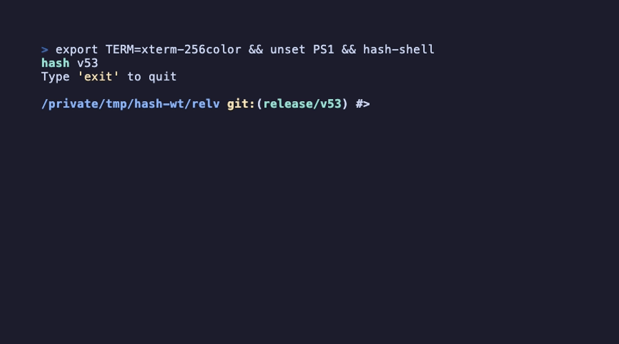

[](https://github.com/juliojimenez/hash/actions/workflows/tests.yml) [](https://github.com/juliojimenez/hash/actions/workflows/sanitizers.yml) [](https://github.com/juliojimenez/hash/actions/workflows/posix.yml) [](https://github.com/juliojimenez/hash/actions/workflows/debian.yml) [](https://github.com/juliojimenez/hash/actions/workflows/update-homebrew.yml) [](https://github.com/juliojimenez/hash/actions/workflows/docker.yml) [](https://github.com/juliojimenez/hash/actions/workflows/docs.yml) 


# hash
A modern command line interpreter for Linux, macOS, and BSD: a POSIX shell written from scratch in C, one small binary with no dependencies beyond libc, with syntax highlighting, autosuggestions, a git-aware prompt and smart completion built in. [Why hash](https://hash-shell.org/why.html) says what it is good at and how it is tested.

<center></center>

Demo made with [vhs](https://github.com/charmbracelet/vhs).

## Install

### From Release

#### Linux x86_64

```bash
curl -LO https://github.com/juliojimenez/hash/releases/download/v51/hash-shell-v51-linux-x86_64
chmod +x hash-shell-v51-linux-x86_64
sudo mv hash-shell-v51-linux-x86_64 /usr/local/bin/hash-shell
hash-shell
```

#### Linux ARM64

```bash
curl -LO https://github.com/juliojimenez/hash/releases/download/v51/hash-shell-v51-linux-aarch64
chmod +x hash-shell-v51-linux-aarch64
sudo mv hash-shell-v51-linux-aarch64 /usr/local/bin/hash-shell
hash-shell
```

---

#### FreeBSD x86_64

```bash
fetch https://github.com/juliojimenez/hash/releases/download/v51/hash-shell-v51-freebsd-x86_64
chmod +x hash-shell-v51-freebsd-x86_64
sudo mv hash-shell-v51-freebsd-x86_64 /usr/local/bin/hash-shell
hash-shell
```

#### FreeBSD ARM64

```bash
fetch https://github.com/juliojimenez/hash/releases/download/v51/hash-shell-v51-freebsd-aarch64
chmod +x hash-shell-v51-freebsd-aarch64
sudo mv hash-shell-v51-freebsd-aarch64 /usr/local/bin/hash-shell
hash-shell
```

---

#### macOS (Apple Silicon)

```bash
curl -LO https://github.com/juliojimenez/hash/releases/download/v51/hash-shell-v51-darwin-arm64
chmod +x hash-shell-v51-darwin-arm64
sudo mv hash-shell-v51-darwin-arm64 /usr/local/bin/hash-shell
```

---

#### Ubuntu 24.04 (Noble)

```bash
curl -LO https://github.com/juliojimenez/hash/releases/download/v51/hash-shell_51-1.noble_amd64.deb
sudo dpkg -i hash-shell_51-1.noble_amd64.deb
```

#### Ubuntu 22.04 (Jammy)

```bash
curl -LO https://github.com/juliojimenez/hash/releases/download/v51/hash-shell_51-1.jammy_amd64.deb
sudo dpkg -i hash-shell_51-1.jammy_amd64.deb
```

---

#### Debian Bookworm

```bash
curl -LO https://github.com/juliojimenez/hash/releases/download/v51/hash-shell_51-1.bookworm_amd64.deb
sudo dpkg -i hash-shell_51-1.bookworm_amd64.deb
```

#### Debian Trixie

```bash
curl -LO https://github.com/juliojimenez/hash/releases/download/v51/hash-shell_51-1.trixie_amd64.deb
sudo dpkg -i hash-shell_51-1.trixie_amd64.deb
```

---

### From Source

```bash
git clone https://github.com/juliojimenez/hash
cd hash
make
sudo make install
hash-shell
```

### Homebrew (macOS)

```bash
brew install juliojimenez/hash/hash-shell
hash-shell
```

### APT (Debian/Ubuntu)

```bash
# Add repository
echo "deb [trusted=yes] https://hash-shell.org/apt/ stable main" | sudo tee /etc/apt/sources.list.d/hash-shell.list

# Install
sudo apt update
sudo apt install hash-shell
```

Upgrade with `sudo apt upgrade hash-shell`. See the [APT installation page](https://hash-shell.org/installation/apt.html) for more options.

> **URL Change Notice:** The APT repository has moved from `juliojimenez.github.io/hash/` to `hash-shell.org/apt/`. If you previously configured the old URL, update your sources list:
> ```bash
> sudo sed -i 's|juliojimenez.github.io/hash/|hash-shell.org/apt/|' /etc/apt/sources.list.d/hash-shell.list
> sudo apt update
> ```

### Docker

```bash
docker pull juliojimenez/hash-shell
docker run -it juliojimenez/hash-shell
docker run -v $(pwd):/scripts juliojimenez/hash-shell /scripts/myscript.sh
```

## Full Documentation

https://hash-shell.org
