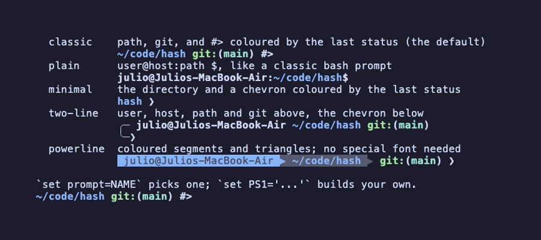
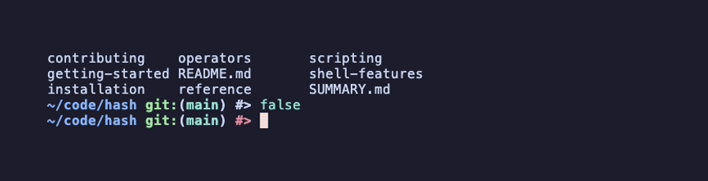
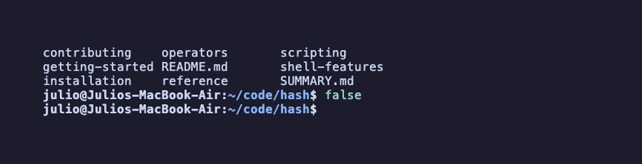
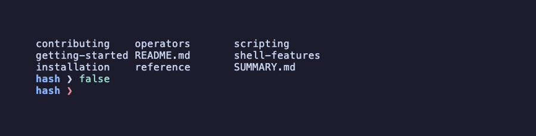
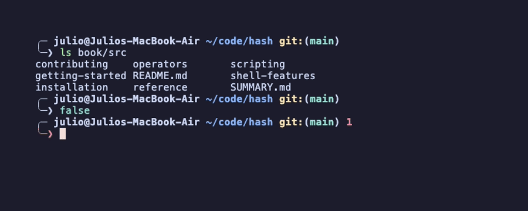
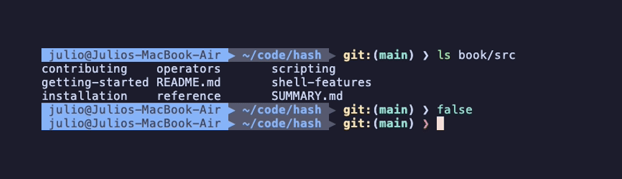

# Prompt Customization

Hash shell supports powerful prompt customization through the `PS1` variable.

## Presets

Pick a prompt by name and it applies at once:

```bash
set prompt=two-line
```

`set prompt=list` shows every preset with a live sample, the current one
marked with `*`:



| Preset | Look |
|--------|------|
| `classic` |  |
| `plain` |  |
| `minimal` |  |
| `two-line` |  |
| `powerline` |  |

- `classic` is the default: path, git branch and status, and `#>` in the colour
  of the last exit status.
- `plain` is the look of a classic bash prompt, `user@host:path$`, without git.
- `minimal` shows the directory name and a chevron coloured by the last status.
- `two-line` puts user, host, path and git on one line and the chevron on the
  next, with a failed status in red before the line break.
- `powerline` draws coloured segments with triangle separators. It uses
  characters every monospace font has, so no patched font is needed.

Put the line in `~/.hashrc` to keep it. The presets use the colour elements
below (`path`, `git_*`, `prompt`, `prompt_error`), so `set color.path=...`
changes them too, except the powerline segments, whose backgrounds are part of
the look. A name that is not a preset fails with the list of names and status 1.

## Default Prompt

```
/home/user/projects git:(main) #>
```

- **Blue** current path
- **Green** `git:` (yellow if dirty)
- **Cyan** branch name
- **Blue** `#>` (red if last command failed)

## Quick Start

In `~/.hashrc`:

```bash
# Simple prompt
set PS1='\W #> '

# Full path with git
set PS1='\w\g \e#>\e '

# User@host:path
set PS1='\u@\h:\w\$ '
```

Or as environment variable:

```bash
export PS1='\w\g \e#>\e '
```

## Continuation Prompt (PS2)

When a line does not finish a command, for example `for f in *.txt` on its own, hash shows the continuation prompt and keeps reading until the compound command is complete:

```bash
#> for f in *.txt
> do
>   echo "$f"
> done
```

The default is `> `. Set `PS2` to change it:

```bash
export PS2='... '
```

Press `Ctrl+C` at the continuation prompt to abandon the unfinished command.

## Escape Sequences

### Path Information

| Sequence | Description | Example |
|----------|-------------|---------|
| `\w` | Full current path | `/home/user/projects` |
| `\W` | Current directory only | `projects` |

### User Information

| Sequence | Description |
|----------|-------------|
| `\u` | Username |
| `\h` | Hostname |
| `\$` | `$` for user, `#` for root |

### Git Integration

| Sequence | Description |
|----------|-------------|
| `\g` | Git branch with status |

The `\g` sequence:
- Shows nothing outside git repos
- Shows ` git:(branch)` in repos
- `git:` is **green** if clean, **yellow** if dirty
- Branch name is **cyan**

### Exit Code Indicator

| Sequence | Description |
|----------|-------------|
| `\e` | Sets color based on exit code |

Use `\e` before and after text:
```bash
set PS1='\w \e#>\e '
#           ^  ^
#           |  Reset color
#           Set color (blue=success, red=fail)
```

### Special Characters

| Sequence | Output |
|----------|--------|
| `\$` | `#` for root, `$` otherwise |
| `\n` | Newline |
| `\\` | A backslash |
| `\[` `\]` | Ignored; bash wraps colour codes in them and hash measures the codes itself |

### Status, Time, Jobs

| Sequence | Output |
|----------|--------|
| `\?` | The last exit status when it was not 0, otherwise nothing |
| `\b` | The git branch alone, nothing outside a repository |
| `\t` `\T` `\@` | The time: 24-hour, 12-hour, 12-hour with am/pm |
| `\d` | The date, `Thu Nov 06` |
| `\j` | The number of background jobs |
| `\!` | The history number of the command about to be entered |
| `\s` `\v` | The shell name and version |
| `\H` | The full host name (`\h` stops at the first dot) |

## Example Prompts

### Minimal

```bash
set PS1='\W #> '
# Output: projects #>
```

### Classic

```bash
set PS1='\u@\h:\w \$ '
# Output: user@hostname:/home/user $
```

### Full Path with Git

```bash
set PS1='\w\g \e#>\e '
# Output: /home/user/projects git:(main) #>
```

### Two-Line

```bash
set PS1='\w\g\n\e#>\e '
# Output:
# /home/user/projects git:(main)
# #>
```

### Powerline Style

```bash
set prompt=powerline     # the preset; see Presets above
```

## Color Behavior

### Path Colors

`\w` and `\W` are **bold blue**

### Git Colors

- `git:` is **green** when clean
- `git:` is **yellow** when dirty
- Branch name is **cyan**

### Exit Code Colors

- `\e` sets **blue** on success (exit 0)
- `\e` sets **red** on failure (exit non-zero)

## Tips

### Test Before Setting

```bash
#> export PS1='\W\g \e#>\e '
projects git:(main) #>
```

### Keep It Simple

Complex prompts can slow down the shell:

```bash
# Fast
set PS1='\W #> '

# Slower (git checks)
set PS1='\w\g \e#>\e '
```

### Two-Line for Long Paths

```bash
set PS1='\w\g\n\e#>\e '
```

### Disable Git in Large Repos

```bash
set PS1='\w \e#>\e '  # No \g
```

## Troubleshooting

### Colors Not Showing

Enable colors:
```bash
set colors=on
```

Check terminal:
```bash
echo $TERM
# Should be xterm-256color or similar
```

### Git Branch Not Showing

Verify you're in a git repo:
```bash
git status
```

Ensure `\g` is in your PS1.

### Exit Colors Not Working

Wrap characters between two `\e`:

```bash
# Wrong
set PS1='\w \e#> '

# Correct
set PS1='\w \e#>\e '
```

## Comparison with Bash

### Similar

- `\w`, `\W`, `\u`, `\h`, `\H`, `\$`, `\t`, `\T`, `\@`, `\d`, `\j`, `\!`, `\s`, `\v`, `\[`, `\]` work the same
- Color support
- Environment variable support

### Hash-Specific

- `set prompt=NAME` - Presets
- `\?` - Last exit status when non-zero, `\b` - bare git branch
- `\g` - Git integration
- `\e` - Exit code color
- Automatic `~` substitution

### Not Supported (Yet)

- `\D{format}` - Date with a custom format
- `PROMPT_COMMAND` - Use `$(...)` in PS1 instead
