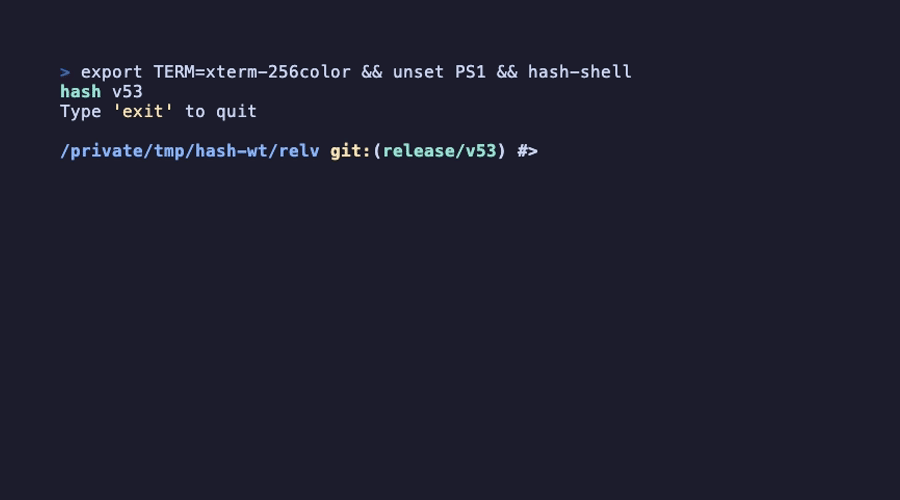

# Why hash

hash is a POSIX shell written from scratch in C, in one binary that needs
nothing but libc. It runs the scripts you already have, and it brings the
things people install plugins for into the shell itself: syntax highlighting as
you type, autosuggestions from your history, a prompt that knows about git,
suggestions when a command name is misspelt, and completion that understands
`cd`, `git`, `make` and `man`.



## It runs POSIX scripts

{{#include conformance.md}}

[smoosh](https://github.com/mgree/smoosh) is a test suite for POSIX shells
built from the standard and from bugs reported on the shells' mailing lists;
it is what hash is measured against on every push, and the figure above is
rewritten from the latest run each time the site is published. Bugs it has
caught, from arithmetic on special parameters to the exit status of an `EXIT`
trap, are fixed in the shell, not worked around in the tests.
A test that still fails stays in the count and gets an issue under the
[posix label](https://github.com/juliojimenez/hash/issues?q=is%3Aissue%20state%3Aopen%20label%3Aposix);
the one skipped test is skipped for a documented reason, linked above.

A second suite, [modernish](https://github.com/modernish/modernish), runs
every week; the shell bugs it still finds are
[tracked openly](https://github.com/juliojimenez/hash/blob/main/tests/modernish/STATUS.md).

## What is built in

| | hash | bash | dash | zsh | fish |
|---|---|---|---|---|---|
| Runs POSIX `sh` scripts | yes | yes | yes | in `sh` emulation | no |
| Syntax highlighting as you type | built in | no | no | plugin | built in |
| Autosuggestions from history | built in | no | no | plugin | built in |
| Git branch and status in the prompt | built in, with [presets](shell-features/prompt.md#presets) | scripts | no | `vcs_info` or plugin | built in |
| "Did you mean" for a misspelt command | built in | handler script | no | `setopt correct` | built in |
| Completion for `git`, `make`, `man`, variables | built in | bash-completion package | no | compsys | built in |
| Programmable completion | `complete -W`, `-F` | `complete` | no | compsys | `complete` |
| Vi editing mode | yes | yes | no | yes | yes |
| Dependencies beyond libc | none | readline, ncurses | none | ncurses | several |

"plugin", "package", "handler" and "scripts" mean the shell can get the
feature from something you add. hash ships it. The other shells are described
as they are installed by their packages; some are more capable in other ways,
and dash is smaller.

## Size

The macOS Apple Silicon binary of the latest release is 261 KB; the static
Linux x86_64 binary, with libc inside it, is 1.4 MB
([release assets](https://github.com/juliojimenez/hash/releases/latest)). It
starts in a few milliseconds and reads no configuration beyond `~/.hashrc`.

## How it is tested

Every push runs, on GitHub Actions, where you can read the results:

- the unit tests, the integration script and a pseudo-terminal harness that
  types at a real prompt, on Linux, macOS and FreeBSD, with gcc and clang
  ([Tests](https://github.com/juliojimenez/hash/actions/workflows/tests.yml));
- the 186 smoosh conformance tests
  ([POSIX Compliance](https://github.com/juliojimenez/hash/actions/workflows/posix.yml));
- AddressSanitizer, UndefinedBehaviorSanitizer, ThreadSanitizer,
  MemorySanitizer and Valgrind over the tests, and AFL++ fuzzing of the
  tokenizer, the parser, variable expansion and the string helpers
  ([Sanitizers & Fuzzing](https://github.com/juliojimenez/hash/actions/workflows/sanitizers.yml)).

Only the latest release is supported, and a security fix ships as a new
release ([security policy](contributing/security.md)).

## Try it

```bash
brew install juliojimenez/hash/hash-shell      # macOS
sudo apt install hash-shell                     # Debian and Ubuntu, after adding the repository
docker run -it juliojimenez/hash-shell          # anywhere with Docker
```

The [installation pages](installation/README.md) have the APT repository line,
the FreeBSD binaries and the build from source. Nothing changes until you make
it your login shell; `hash-shell` runs it as a command like any other.
